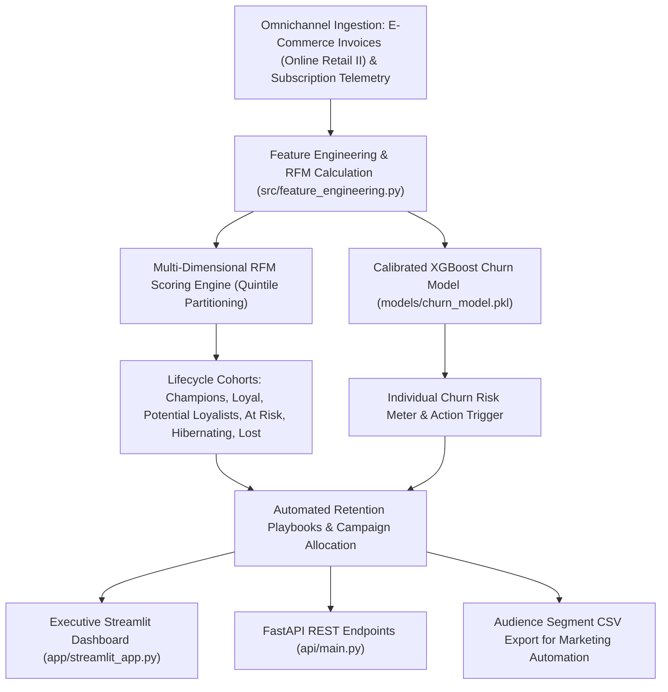

# Customer Lifecycle Value (CLV) & Behavioral Segmentation Platform

[](https://customer-segmentation-efb7gqwwg2sqdzpymxxbz5.streamlit.app/)


An enterprise customer intelligence platform combining multi-dimensional RFM (Recency, Frequency, Monetary) behavioral clustering with predictive churn machine learning to maximize customer lifetime value (CLV) and drive automated retention playbooks.

---

## Architecture Flow



---

## Commercial Use Case

Direct-to-consumer retailers, telecom operators, and subscription SaaS providers often manage retention reactively—after a customer cancels. Blanket discounts sent indiscriminately erode operating margins.

This system solves both challenges simultaneously:
1. **RFM Lifecycle Segmentation**: Quantifies customer engagement patterns into distinct behavioral tiers (e.g. Champions driving over 50% of revenue from less than 20% of the customer base).
2. **Predictive Defection Telemetry**: Intercepts churn propensity before contract expiration using subscription duration, technical support engagement, and pricing attributes.
3. **Automated Action Playbooks**: Translates quantitative risk into immediate marketing actions (e.g. VIP loyalty perks for Champions vs high-urgency contract incentives for At Risk High Spenders).

---

## API Endpoints

### 1. Health Verification
```http
GET /health
```
Response:
```json
{
  "status": "healthy",
  "service": "customer-lifecycle-retention",
  "model_loaded": true
}
```

### 2. Predict Churn Risk
```http
POST /predict
Content-Type: application/json

{
  "gender": "Male",
  "SeniorCitizen": 0,
  "Partner": "No",
  "Dependents": "No",
  "tenure": 12,
  "PhoneService": "Yes",
  "MultipleLines": "No",
  "InternetService": "Fiber optic",
  "OnlineSecurity": "No",
  "OnlineBackup": "No",
  "DeviceProtection": "No",
  "TechSupport": "No",
  "StreamingTV": "No",
  "StreamingMovies": "No",
  "Contract": "Month-to-month",
  "PaperlessBilling": "Yes",
  "PaymentMethod": "Electronic check",
  "MonthlyCharges": 75.50,
  "TotalCharges": 906.00
}
```

### 3. Retrieve Segment Benchmarks
```http
GET /api/v1/benchmark-segments
```

---

## Local Setup & Development

### 1. Environment Installation
```bash
git clone https://github.com/MuhammadMinhaj229/customer-segmentation.git
cd customer-segmentation
pip install -r requirements.txt
```

### 2. Run Test Suite
```bash
python -m pytest tests/
```

### 3. Launch Streamlit Executive Hub
```bash
streamlit run app/streamlit_app.py
```

### 4. Launch FastAPI REST Server
```bash
uvicorn api.main:app --host 0.0.0.0 --port 8000 --reload
```
